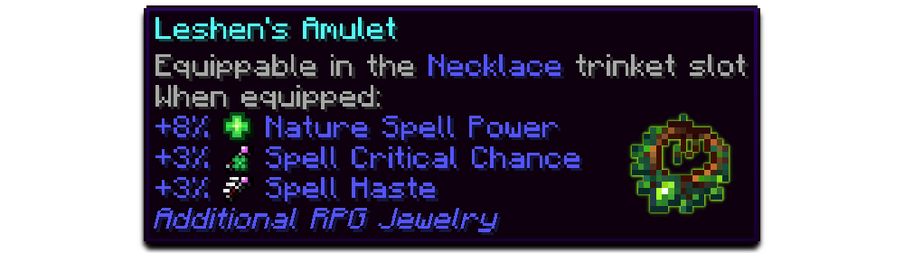
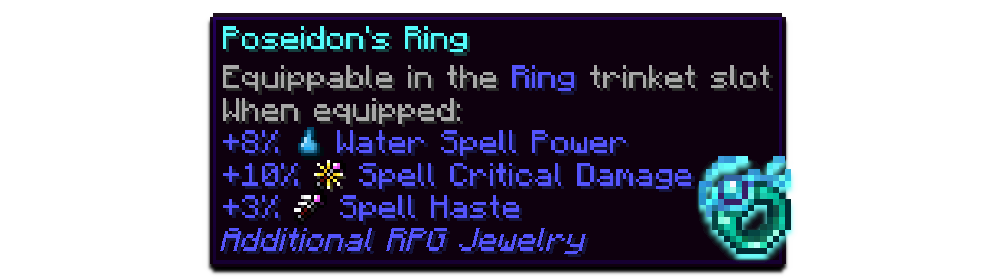

<h1>💍 Additional Rings &amp; Necklaces for RPG-Series Plus Classes - (More RPG Classes)!</h1>
    

---

## 📂 Installation

### 🚨 Required Mods

<table>
<thead><tr><th>Mod</th><th>Download</th></tr></thead>
<tbody>
<tr><td><b>Jewelry</b></td><td> </td></tr>
<tr><td><b>More RPG Library</b></td><td> </td></tr>
</tbody></table>

### 👍 Highly Recommended / Compatibility Mods

<b>Show recommended &amp; compatible mods</b>

<table>
<thead><tr><th>Mod</th><th>Compatibility Info</th><th>Download</th></tr></thead>
<tbody>
<tr><td><b>Witcher</b></td><td>Unlocks the Silver Sapphire jewelry with Witcher sign bonuses</td><td> </td></tr>
</tbody></table>

---

## 🕹️ Features

Additional RPG Jewelry is an add-on for the <a href="https://www.curseforge.com/minecraft/mc-mods/jewelry">Jewelry</a> mod and adds a whole new set of rings and necklaces with unique stat bonuses:

---

## ⚙️ Configuration

<b>Show config files</b>

<table>
<thead><tr><th>Setting</th><th>File</th></tr></thead>
<tbody>
<tr><td>Jewelry bonuses</td><td><code>config/additional_rpg_jewelry/items.json</code></td></tr>
<tr><td>Loot</td><td><code>config/rpg_series/loot.json</code></td></tr>
</tbody></table>

---

## 🙌 Credits

<b>Show credits</b>

<table>
<thead><tr><th>Who</th><th>Contribution</th></tr></thead>
<tbody>
<tr><td>Tobefriend (Rocket Studio)</td><td>Created the awesome mod banner</td></tr>
</tbody></table>

---

<h3>🧙‍♂️ Check out my other RPG-themed mods!</h3>
<table>
<tbody>
<tr><td align="center" style="text-align:center"></td><td align="center" style="text-align:center"></td><td align="center" style="text-align:center"></td><td align="center" style="text-align:center"></td></tr>
</tbody>
</table>

<h3>✨ Discover more of the RPG Series by Daedelus</h3>
<table>
<tbody>
<tr><td align="center" style="text-align:center"></td><td align="center" style="text-align:center"></td><td align="center" style="text-align:center"></td></tr>
<tr><td align="center" style="text-align:center"></td><td align="center" style="text-align:center"></td><td align="center" style="text-align:center"></td></tr>
<tr><td align="center" style="text-align:center"></td><td align="center" style="text-align:center"></td><td align="center" style="text-align:center"></td></tr>
</tbody>
</table>

<h3>🌟 More RPG content by other Spell Engine devs</h3>
<table>
<tbody>
<tr><td align="center" style="text-align:center"></td><td align="center" style="text-align:center"></td><td align="center" style="text-align:center"></td></tr>
</tbody>
</table>

---

💬 Questions, bugs or ideas? Join the <a href="https://discord.com/invite/AShKd5XrTu">Discord</a> or open an issue on <a href="https://github.com/ProfessorFichte/Additional-RPG-Jewelry/issues">GitHub</a>.

